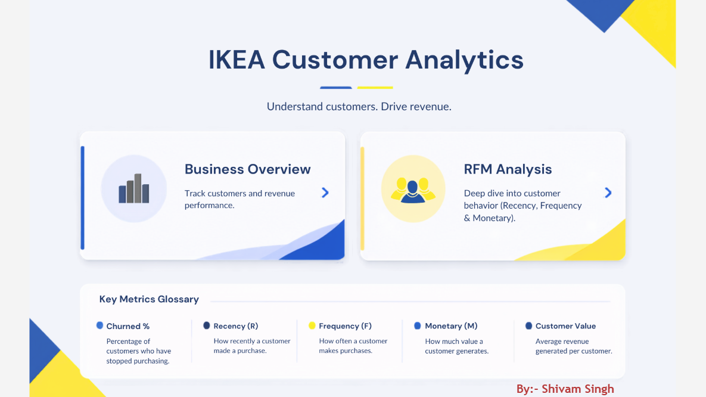
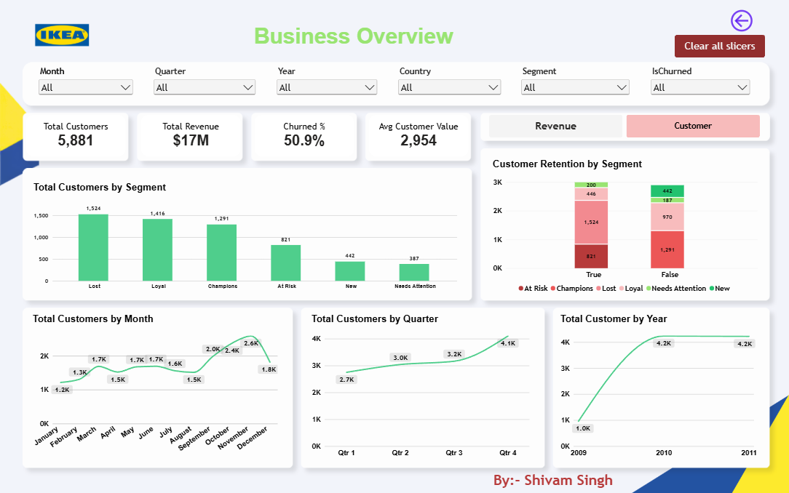
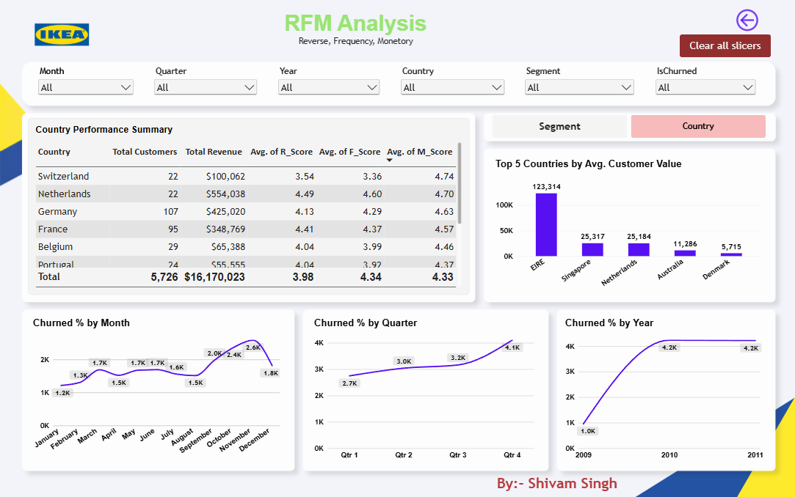

# E-commerce Customer Analytics & RFM Segmentation

## Project Overview
This is an end-to-end E-commerce Data Analytics project built using SQL Server, Python (Pandas), Excel, and Power BI.
The project focuses on cleaning online retail transaction data, performing RFM (Recency, Frequency, Monetary) analysis, 
segmenting customers based on purchasing behavior, and developing an interactive three-page Power BI dashboard.

## Business Objective
The objective of this project is to analyze e-commerce transaction data and understand customer purchasing behavior.

Key objectives:
- Clean and prepare raw retail transaction data.
- Combine multiple datasets into one cleaned dataset.
- Analyze customer purchasing patterns.
- Perform RFM analysis and customer segmentation.
- Build an interactive Power BI dashboard for business insights.

## Tools & Technologies
- **SQL Server:** Data import, data cleaning, data transformation and duplicate handling.
- **Python (Pandas):** Data processing, RFM analysis and customer segmentation.
- **Excel:** Preparing the final dataset for Power BI.
- **Power BI:** Interactive dashboard development and data visualization.

## Project Workflow
### 1. Data Import & Cleaning – SQL Server
- Imported two Online Retail CSV datasets into SQL Server.
- Combined both datasets using SQL.
- Handled duplicate records and prepared the cleaned dataset.
- Created the final `RetailCleaned` table.

### 2. RFM Analysis – Python
- Imported cleaned data into Jupyter Notebook using Pandas.
- Processed transaction dates and customer records.
- Calculated Recency, Frequency and Monetary values.
- Assigned RFM scores and customer segments.

### 3. Final Dataset – Excel
- Prepared the customer segmentation output.
- Created `EcommerceDashboardData.xlsx` for Power BI reporting.

### 4. Dashboard Development – Power BI
- Imported the final Excel dataset.
- Created a three-page interactive dashboard.
- Added visualizations, KPIs and slicers to explore customer analytics.

## Repository Structure

- `Dataset/` – Dataset information and download instructions.
- `SQL/` – SQL queries for data import and cleaning.
- `Python/` – Jupyter Notebook for RFM analysis.
- `Excel/` – Final dataset used for Power BI.
- `PowerBI/` – Power BI report and dashboard screenshots.

## Dashboard Preview

### 1. E-commerce Sales Overview Dashboard

### 2. Customer Analytics Dashboard

### 3. RFM Customer Segmentation Dashboard

## How to Run This Project
1. Download the source dataset using the instructions in the Dataset folder.
2. Import the CSV files into SQL Server.
3. Execute the SQL script to prepare the cleaned dataset.
4. Open the Jupyter Notebook and perform RFM analysis.
5. Prepare the final Excel dataset.
6. Open the Power BI file to explore the interactive dashboard.

## Key Learning Outcomes
- SQL data cleaning and transformation.
- Working with large retail transaction datasets.
- Python Pandas data processing.
- RFM analysis and customer segmentation.
- Excel data preparation.
- Power BI dashboard development.

## Author:-
**Shivam Singh**
